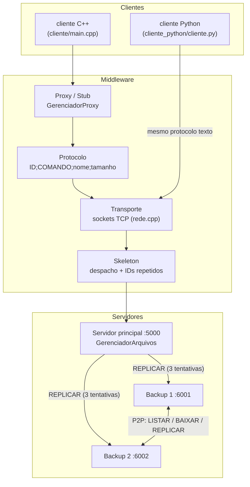
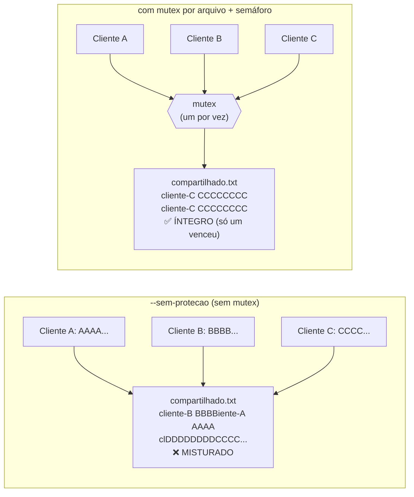

# backup-distribuido-arquivos

Sistema distribuído **didático** de gerenciamento de arquivos com servidores de
backup, feito para a disciplina de **Sistemas Distribuídos**.

Usuários **enviam, listam, baixam e removem** arquivos de texto pequenos em um
**servidor principal**. Cada envio é **replicado automaticamente** para
**servidores de backup**. Se o principal cair, os arquivos continuam disponíveis
nos backups, e os backups **sincronizam entre si (peer-to-peer)**.

Tudo em C++17 com a biblioteca padrão + sockets POSIX (e um cliente em Python 3).
Nenhum framework externo, banco de dados, interface gráfica ou autenticação.

## O problema que resolve

Um único servidor de arquivos é um **ponto único de falha**: se ele cair, ou o
disco estragar, os usuários perdem acesso a tudo. Este sistema guarda **cópias
em várias máquinas**, mantém essas cópias **coerentes** (versões) e garante que
**escritas simultâneas** no mesmo arquivo não o corrompam (mutex + semáforo).

---

## Estrutura

```
middleware/          proxy (stub), skeleton, protocolo e sockets — a "infraestrutura"
servico/             GerenciadorArquivos: o objeto real (disco, mutex, semáforo)
servidor_principal/  servidor principal + backups.txt
servidor_backup/     servidor de backup + sincronização P2P + peers.txt
cliente/             cliente de linha de comando em C++ (só usa o proxy)
cliente_python/      cliente em Python falando o mesmo protocolo
teste/               corrida.sh (condição de corrida) e demo_replicacao.sh
docs/                protocolo.md (contrato/API) e roteiro de apresentação
```

## Como compilar

Precisa de `g++` (C++17), `make` e, para o segundo cliente, `python3`. Linux ou macOS.

```bash
make            # compila tudo em bin/
```

Ou separado: `make principal`, `make backup`, `make cliente`.

## Demonstração passo a passo (4 terminais)

Todos os comandos são executados **na raiz do projeto**.

**Terminal 1 — backup 1**
```bash
./bin/backup 6001 dados/backup1
```

**Terminal 2 — backup 2**
```bash
./bin/backup 6002 dados/backup2
```

**Terminal 3 — servidor principal**
```bash
./bin/principal
```
(padrões: porta 5000, pasta `dados/principal`, backups de `servidor_principal/backups.txt`)

**Terminal 4 — cliente**
```bash
echo "Minha primeira nota" > nota.txt
./bin/cliente enviar nota.txt                    # envia (e o principal replica)
./bin/cliente listar                             # nota.txt versão 1
./bin/cliente -s localhost:6001 listar           # o backup 1 também tem
./bin/cliente baixar nota.txt                    # mostra o conteúdo
python3 cliente_python/cliente.py listar         # o cliente Python vê o mesmo
```

Agora **derrube o principal** (Ctrl+C no Terminal 3) e, no Terminal 4:

```bash
./bin/cliente baixar nota.txt
# [proxy] localhost:5000 fora do ar (conexão recusada)
# Minha primeira nota
# (atendido por localhost:6001)
```

O proxy percebeu a falha e foi sozinho para o backup. Outros testes:

| O que mostrar | Como |
|---|---|
| P2P | Derrube o backup 2, envie um arquivo (com o principal fora, vai pro backup 1), religue o backup 2 e rode `./bin/cliente -s localhost:6002 listar` |
| Falha parcial | Com o backup 2 fora, envie pelo principal: ele tenta 3 vezes e grava em `dados/falhas_replicacao.log` |
| ID repetido | `./bin/cliente duplicar nota.txt` e depois `listar`: a versão subiu só 1 |
| Corrida | `teste/corrida.sh` (ver seção de concorrência) |

Atalho: `teste/demo_replicacao.sh` faz toda a demonstração acima sozinho
(apaga `dados/principal`, `dados/backup1` e `dados/backup2` antes).

---

## Explicação dos tópicos

### 1. Interação cliente-servidor

O cliente **abre uma conexão TCP**, manda uma **requisição** e espera a
**resposta**. O servidor fica num laço `accept()` e cria **uma thread por
cliente** (`Skeleton::servir`), então vários clientes são atendidos ao mesmo
tempo. Os servidores também são clientes uns dos outros: o principal é cliente
dos backups (replicação) e cada backup é cliente do outro (P2P).

### 2. Papel de cada componente

| Componente | Papel |
|---|---|
| `cliente/` | Interface de linha de comando. Chama `gerenciador.enviar(...)` sem saber de sockets. |
| `cliente_python/` | Mesmo papel, em outra linguagem: prova que o contrato é o protocolo. |
| `middleware/` | Esconde a rede: `rede` (sockets), `protocolo` (empacotar), `proxy` (stub), `skeleton` (despacho). |
| `servico/` | `GerenciadorArquivos`: o objeto real que lê/grava no disco com mutex e semáforo. |
| `servidor_principal/` | Atende clientes e replica cada ENVIAR/REMOVER para os backups (3 tentativas). |
| `servidor_backup/` | Guarda cópias, atende clientes se o principal cair e sincroniza P2P com os vizinhos. |

### 3. API × Middleware

- **API** = o **contrato** que o cliente enxerga: `listar()`, `enviar(nome, conteudo)`,
  `baixar(nome)`, `remover(nome)`, com seus resultados e erros (`ARQUIVO_INEXISTENTE`...).
  Responde *"o que posso pedir?"*.
- **Middleware** = a **infraestrutura** que faz isso funcionar pela rede: abre socket,
  monta o cabeçalho `ID;COMANDO;nome;tamanho`, gera ID, espera resposta, troca de
  servidor se um cair. Responde *"como o pedido chega lá?"*.

Detalhes em [`docs/protocolo.md`](docs/protocolo.md).

### 4. Arquitetura e protocolo

Arquitetura em camadas: aplicação → API → middleware → transporte TCP.



Protocolo: texto sobre TCP, cabeçalho de uma linha e conteúdo em seguida.

```
Requisição: ID;COMANDO;nome;tamanho[;versao]\n<conteúdo>
Resposta:   ID;OK;tamanho\n<conteúdo>     ou     ID;ERRO;motivo\n
```

Sequência de um envio com replicação:

```mermaid
sequenceDiagram
    participant U as Cliente
    participant P as Principal
    participant B1 as Backup 1
    participant B2 as Backup 2
    U->>P: 7f3a;ENVIAR;nota.txt;20 + conteúdo
    Note over P: semáforo (vaga) + mutex(nota.txt)<br/>grava em pedaços, versão 1
    P-->>U: 7f3a;OK;0
    par replicação assíncrona (uma thread por backup)
        P->>B1: rep-7f3a;REPLICAR;nota.txt;20;1
        B1-->>P: rep-7f3a;OK;0
    and
        P->>B2: rep-7f3a;REPLICAR;nota.txt;20;1
        Note over P,B2: B2 fora do ar: tenta 3x,<br/>depois registra no log
    end
    B1->>B2: P2P: LISTAR / REPLICAR do que falta
```

### 5. Objetos distribuídos e serviços (Proxy / Skeleton / RPC)

O cliente escreve `gerenciador.baixar("nota.txt")` como se `gerenciador` fosse um
objeto local. Na verdade, `gerenciador` é um **proxy** (stub): ele empacota a
chamada, manda pela rede e devolve o resultado. Do outro lado, o **skeleton**
desempacota, chama o objeto **real** (`GerenciadorArquivos`) e empacota a
resposta. Isso é **RPC** (chamada de procedimento remoto) / **objetos distribuídos**.

```mermaid
sequenceDiagram
    participant App as cliente/main.cpp
    participant Px as Proxy (stub)
    participant Rede as TCP
    participant Sk as Skeleton
    participant Obj as GerenciadorArquivos (objeto real)
    App->>Px: baixar("nota.txt")
    Px->>Px: gera ID + empacota<br/>"9c01;BAIXAR;nota.txt;0"
    Px->>Rede: envia bytes
    Rede->>Sk: recebe bytes
    Sk->>Sk: desempacota + confere ID repetido
    Sk->>Obj: baixar("nota.txt")
    Obj-->>Sk: "Minha primeira nota"
    Sk->>Rede: "9c01;OK;20" + conteúdo
    Rede->>Px: resposta
    Px-->>App: return "Minha primeira nota"
```

**ID único de requisição:** cada chamada leva um ID. O skeleton guarda as
respostas das alterações já feitas; se o mesmo ID chegar de novo (cliente reenviou),
ele devolve a resposta guardada **sem gravar outra vez** (teste: `cliente duplicar`).

### 6. Heterogeneidade

O sistema mistura:

- **Linguagens:** servidores e um cliente em **C++**, outro cliente em **Python**.
- **Formato de dados:** **texto** com cabeçalho legível (nada de structs binárias,
  que dependeriam de alinhamento e ordem de bytes de cada máquina).
- **Sistemas operacionais:** o código usa sockets POSIX (Linux, macOS, WSL); o
  cliente Python roda até no Windows. Basta trocar `localhost` pelo IP da máquina
  em `backups.txt`, `peers.txt` ou na opção `-s`.

A **interoperabilidade vem do protocolo comum** (`docs/protocolo.md`): quem
seguir o contrato conversa com o sistema, não importa a linguagem.

### 7. Dificuldades de sistemas distribuídos

| Dificuldade | Onde aparece aqui | O que fizemos |
|---|---|---|
| **Latência** | Rede é lenta comparada à memória; a escrita é propositalmente lenta | Replicação **assíncrona** (o cliente não espera os backups); timeout de 15 s nos sockets |
| **Falha parcial** | Um backup cai e o resto continua | 3 tentativas com pausa de 1 s, depois registra em `dados/falhas_replicacao.log`; o proxy troca de servidor (failover) |
| **Relógios** | Cada máquina tem seu relógio; "o mais recente pela hora" não é confiável | Usamos **número de versão** (contador lógico) em vez de horário |
| **Versões / consistência** | Backup que ficou desligado tem cópia velha | Na sincronização **vence a versão maior**; o P2P completa o que faltou |
| **Mensagens duplicadas** | Cliente reenvia porque achou que perdeu a resposta | **ID único**: servidor ignora repetidos |

Limitações conhecidas (simplificações didáticas): o principal não sincroniza com
os backups quando volta; uma remoção feita enquanto um backup está fora pode ser
"ressuscitada" pelo P2P (resolveria com *tombstones*); dois envios *diretos* em
backups diferentes podem gerar a mesma versão com conteúdos diferentes.

### 8. Peer-to-peer

Os backups não dependem do principal para se atualizar. Cada backup lê os vizinhos
em `servidor_backup/peers.txt` e, **ao ligar** e **a cada arquivo recebido**:

1. pede `LISTAR` ao vizinho (nome + versão);
2. **baixa** o que o vizinho tem com versão maior;
3. **envia** (`REPLICAR`) o que ele próprio tem com versão maior.

Cada nó é **cliente e servidor ao mesmo tempo** (usa o proxy para falar com o
vizinho e o skeleton para atender). Código: `servidor_backup/p2p.cpp`.

### 9. Semáforos e concorrência

O servidor atende cada cliente numa thread. Se dois clientes gravarem o **mesmo
arquivo** ao mesmo tempo, os pedaços se misturam. Para a falha ficar visível, a
escrita é feita **em pedaços de 16 bytes com pausa de 5 ms**.

- **`std::mutex` por arquivo:** só uma thread escreve (ou lê) um arquivo por vez.
  Arquivos diferentes continuam em paralelo.
- **Semáforo contador (POSIX `sem_t`, valor 3):** no máximo 3 transferências
  simultâneas. A quarta espera até 5 s; se não abrir vaga, recebe `SERVIDOR_OCUPADO`.
- **`--sem-protecao`:** desliga mutex e semáforo para mostrar o problema.

```bash
teste/corrida.sh        # 5 clientes; ou: teste/corrida.sh 8
```

O script sobe um principal isolado (porta 5099), dispara vários clientes ao mesmo
tempo enviando conteúdos diferentes (`AAAA...`, `BBBB...`) para `compartilhado.txt`,
e confere o resultado: com `--sem-protecao` ⇒ **CORROMPIDO**; normal ⇒ **ÍNTEGRO**.



---

## Referência rápida

```
./bin/principal [porta] [pasta] [arquivo_backups] [--sem-protecao]
./bin/backup <porta> <pasta> [arquivo_peers] [--sem-protecao]
./bin/cliente [-s host:porta]... listar | enviar <arq> [nome] | baixar <nome> [destino]
                                 | remover <nome> | duplicar <arq>
python3 cliente_python/cliente.py [-s host:porta]... listar | enviar | baixar | remover
```

Roteiro da apresentação: [`docs/roteiro_apresentacao.md`](docs/roteiro_apresentacao.md).
